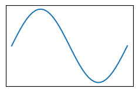
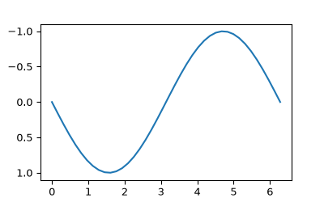
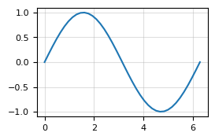
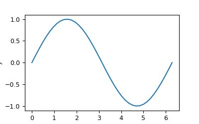
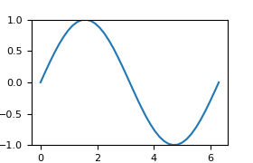
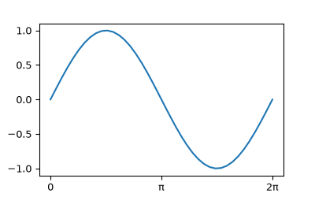
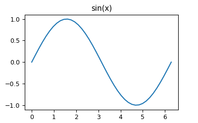

# axis

## Overview

`AxisMixin`, the axis methods of `MatplotGraphMaker`: labels, limits, ticks, axis direction, titles and grids.

## Components

| Component | Description |
| --------- | ----------- |
| [`mixin.py`](./mixin.py) | `AxisMixin` |
| [`parameters/`](./parameters/README.md) | Parameter dataclasses of `set_grid` and tick styling |
| [`keyword_arguments/`](./keyword_arguments/README.md) | TypedDicts the parameters' `to_dict` returns |
| [`readme_figures/`](./readme_figures) | An example figure of every axis method, checked by `tests/test_readme_axis_figures.py` |

## Examples

```python
from matplotlib_utilities import GraphAxis, MatplotGraphMaker

maker = MatplotGraphMaker()
maker.plot(x=x, y=y)
maker.set_label(label="time [s]", axis=GraphAxis.X)
maker.set_lim(lower=0.0, upper=1.0, axis=GraphAxis.Y)
maker.set_title(title="Response")
maker.finalize()
```

One figure per axis method, generated from [`readme_figures/`](./readme_figures):

      
