# draw

## Overview

`DrawMixin`, the drawing methods of `MatplotGraphMaker`. Each takes its options as a frozen `*Parameters` dataclass whose `to_dict` returns a TypedDict, so type checkers check every keyword argument against the Matplotlib `Axes` method it is unpacked into.

## Components

| Component | Description |
| --------- | ----------- |
| [`mixin.py`](./mixin.py) | `DrawMixin`, which composes the family mixins and adds `legend`, `line`, `annotate` and `span` |
| [`mixins/`](./mixins/README.md) | Drawing methods grouped by plot family |
| [`parameters/`](./parameters/README.md) | Parameter dataclasses of the drawing methods |
| [`keyword_arguments/`](./keyword_arguments/README.md) | TypedDicts the parameters' `to_dict` returns |
| [`readme_figures/`](./readme_figures) | An example figure of every drawing method, checked by `tests/test_readme_figures.py` |

## Examples

```python
from matplotlib_utilities import ColorMap, ImshowParameters, MatplotGraphMaker

maker = MatplotGraphMaker()
image = maker.imshow(image=values, subparams=ImshowParameters(cmap=ColorMap.VIRIDIS))
maker.set_colorbar(mappable=image)
maker.finalize()
```

One figure per drawing method, generated from [`readme_figures/`](./readme_figures):

| Family | Figures |
| ------ | ------- |
| distribution | 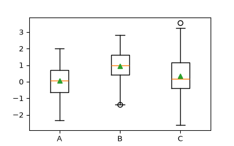 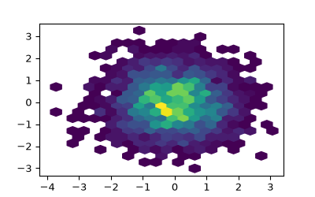 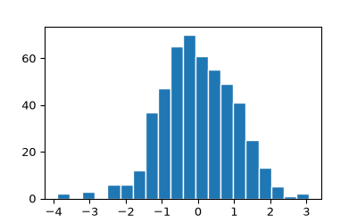 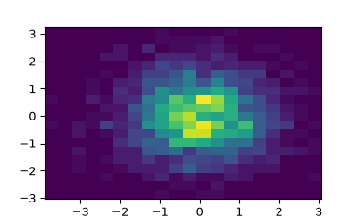 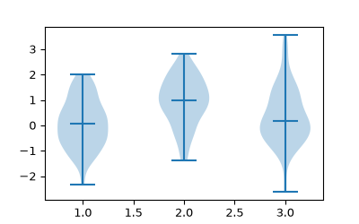 |
| image | 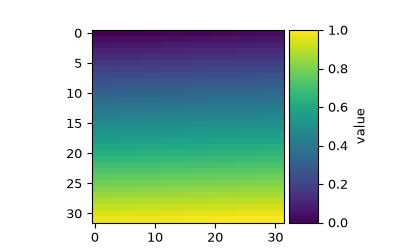 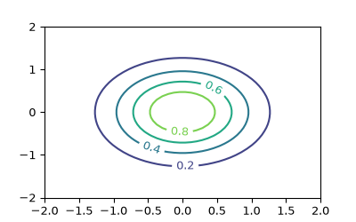 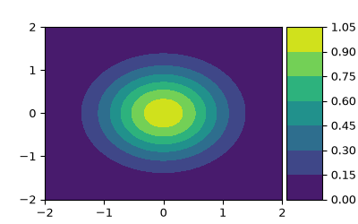 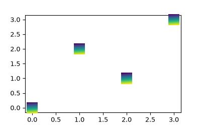 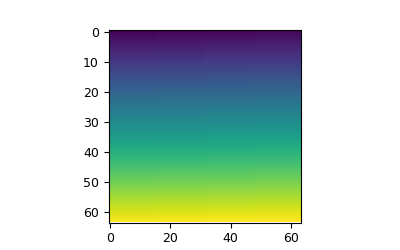 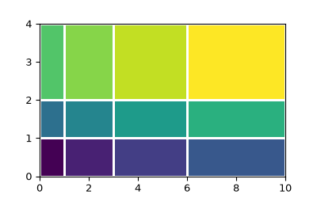 |
| misc | 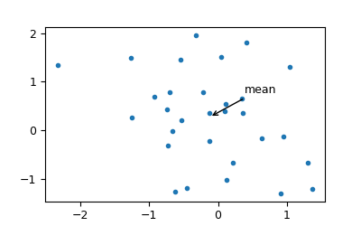 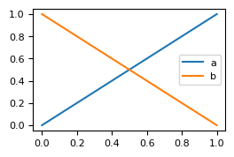 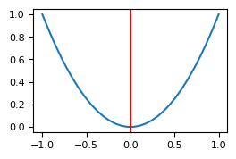 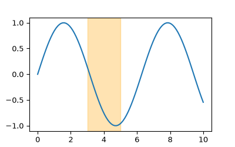 |
| proportion | 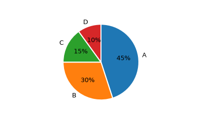 |
| series | 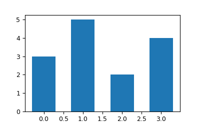 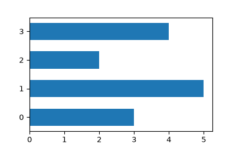 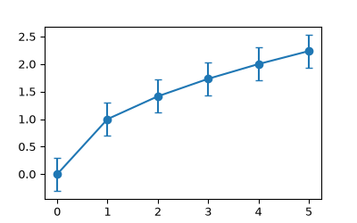 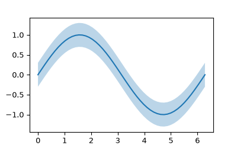 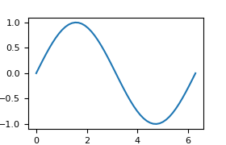 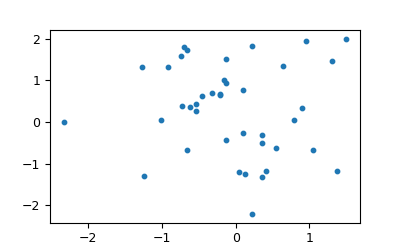 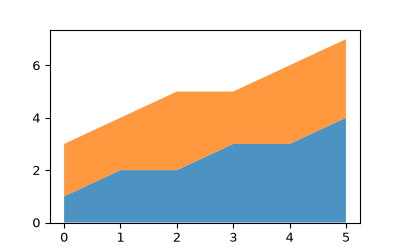 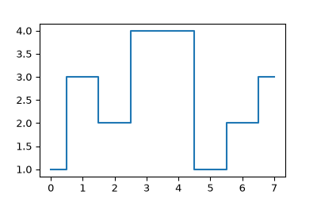 |
| vector | 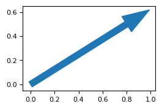 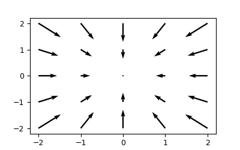 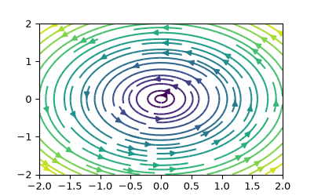 |
