# draw

## Overview

Drawing helpers on `MatplotGraphMaker` (`maker.scatter`, `maker.imshow`, …). Parameters live under [`parameters/`](./parameters/).

Parameters are frozen dataclasses; derive a variant with `rebuild(...)` instead of assigning to a field. Finite choices such as markers, colormaps, alignments and hatches are enums, never strings. `to_dict` returns a TypedDict from [`keyword_arguments/`](./keyword_arguments/), so mypy and basedpyright check every keyword argument against the Matplotlib signature it is unpacked into.

`DrawMixin` composes the mixins under [`mixins/`](./mixins/) and adds a few methods on [`mixin.py`](./mixin.py).

This page covers how to call those helpers through this library. For argument semantics, styling options, and behavior not described here, see the [Matplotlib documentation](https://matplotlib.org/stable/api/index.html) for the underlying `Axes` methods (e.g. [`Axes.scatter`](https://matplotlib.org/stable/api/_as_gen/matplotlib.axes.Axes.scatter.html)).

If something you need is missing from this package, open an [issue](https://github.com/ry-yoshida-private/MatplotlibUtilities/issues).

## API map

<table>
<thead>
<tr>
<th>Mixin</th>
<th>Methods on <code>MatplotGraphMaker</code></th>
</tr>
</thead>
<tbody>
<tr>
<td><a href="./mixins/distribution.py"><code>DistributionDrawMixin</code></a></td>
<td>
<ul>
<li><code>hist</code></li>
<li><code>boxplot</code></li>
<li><code>violinplot</code></li>
<li><code>hexbin</code></li>
<li><code>hist2d</code></li>
</ul>
</td>
</tr>
<tr>
<td><a href="./mixins/image.py"><code>ImageDrawMixin</code></a></td>
<td>
<ul>
<li><code>imshow</code></li>
<li><code>set_colorbar</code></li>
<li><code>contour</code></li>
<li><code>contourf</code></li>
<li><code>pcolormesh</code></li>
<li><code>imscatter</code></li>
</ul>
</td>
</tr>
<tr>
<td><a href="./mixins/proportion.py"><code>ProportionDrawMixin</code></a></td>
<td>
<ul>
<li><code>pie</code></li>
</ul>
</td>
</tr>
<tr>
<td><a href="./mixins/series.py"><code>SeriesDrawMixin</code></a></td>
<td>
<ul>
<li><code>plot</code></li>
<li><code>scatter</code></li>
<li><code>bar</code></li>
<li><code>barh</code></li>
<li><code>step</code></li>
<li><code>errorbar</code></li>
<li><code>fill_between</code></li>
<li><code>stackplot</code></li>
</ul>
</td>
</tr>
<tr>
<td><a href="./mixins/vector.py"><code>VectorDrawMixin</code></a></td>
<td>
<ul>
<li><code>arrow</code></li>
<li><code>quiver</code></li>
<li><code>streamplot</code></li>
</ul>
</td>
</tr>
<tr>
<td><a href="./mixin.py"><code>DrawMixin</code></a></td>
<td>
<ul>
<li><code>legend</code></li>
<li><code>line</code></li>
<li><code>annotate</code></li>
<li><code>span</code></li>
</ul>
</td>
</tr>
</tbody>
</table>

## imshow

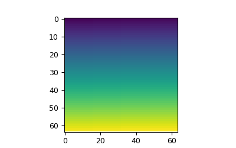

<details>
<summary>Code</summary>

```python
import numpy as np
from matplotlib_utilities import GraphLayout, GraphParameters, ImshowParameters, MatplotGraphMaker, TableAxis

layout = GraphLayout.from_number(number=1, axis=TableAxis.COLUMN, axis_value=1)
maker = MatplotGraphMaker(layout=layout, parameters=GraphParameters())
data = np.linspace(0, 1, 64 * 64).reshape(64, 64)
idx = maker.get_subplot_index_from_number(number=0)
maker.imshow(image=data, index=idx, subparams=ImshowParameters())
maker.finalize(save_path="out.png", is_showing_result_enabled=False)
```

</details>

## set_colorbar

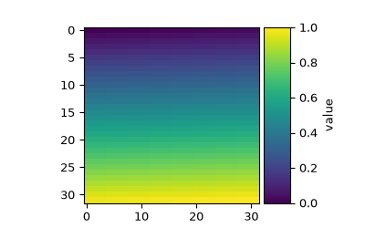

Pass the artist a draw call returns (`imshow`, `contourf`, `pcolormesh`, `hexbin`, `hist2d`, `scatter`) as `mappable` so the colorbar shares its colormap, normalization and levels. Pass `image` instead to build a standalone scale from the data range and the `cmap`, `vmin` and `vmax` of `ColorbarParameters`.

<details>
<summary>Code</summary>

```python
import numpy as np
from matplotlib_utilities import (
    ColorbarParameters,
    GraphLayout,
    GraphParameters,
    ImshowParameters,
    MatplotGraphMaker,
    TableAxis,
)

layout = GraphLayout.from_number(number=1, axis=TableAxis.COLUMN, axis_value=1)
maker = MatplotGraphMaker(layout=layout, parameters=GraphParameters())
data = np.linspace(0, 1, 32 * 32).reshape(32, 32)
idx = maker.get_subplot_index_from_number(number=0)
image = maker.imshow(image=data, index=idx, subparams=ImshowParameters())
maker.set_colorbar(index=idx, mappable=image, subparams=ColorbarParameters(label="value"))
maker.finalize(save_path="out.png", is_showing_result_enabled=False)
```

</details>

## plot

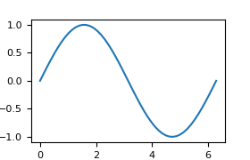

<details>
<summary>Code</summary>

```python
import numpy as np
from matplotlib_utilities import GraphLayout, GraphParameters, MatplotGraphMaker, PlotParameters, TableAxis

layout = GraphLayout.from_number(number=1, axis=TableAxis.COLUMN, axis_value=1)
maker = MatplotGraphMaker(layout=layout, parameters=GraphParameters())
x = np.linspace(0, 2 * np.pi, 50)
idx = maker.get_subplot_index_from_number(number=0)
maker.plot(x=x, y=np.sin(x), index=idx, subparams=PlotParameters())
maker.finalize(save_path="out.png", is_showing_result_enabled=False)
```

</details>

## scatter

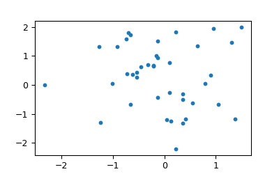

<details>
<summary>Code</summary>

```python
import numpy as np
from matplotlib_utilities import GraphLayout, GraphParameters, MatplotGraphMaker, ScatterParameters, TableAxis

layout = GraphLayout.from_number(number=1, axis=TableAxis.COLUMN, axis_value=1)
maker = MatplotGraphMaker(layout=layout, parameters=GraphParameters())
rng = np.random.default_rng(0)
x, y = rng.standard_normal(40), rng.standard_normal(40)
idx = maker.get_subplot_index_from_number(number=0)
maker.scatter(x=x, y=y, index=idx, subparams=ScatterParameters(s=40))
maker.finalize(save_path="out.png", is_showing_result_enabled=False)
```

</details>

## bar

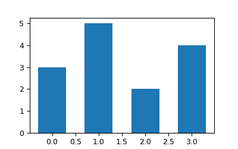

<details>
<summary>Code</summary>

```python
import numpy as np
from matplotlib_utilities import GraphLayout, GraphParameters, MatplotGraphMaker, TableAxis
from matplotlib_utilities.mixin.draw.parameters import BarParameters

layout = GraphLayout.from_number(number=1, axis=TableAxis.COLUMN, axis_value=1)
maker = MatplotGraphMaker(layout=layout, parameters=GraphParameters())
idx = maker.get_subplot_index_from_number(number=0)
maker.bar(
    x=np.arange(4.0),
    height=np.array([3.0, 5.0, 2.0, 4.0]),
    index=idx,
    subparams=BarParameters(width=0.6),
)
maker.finalize(save_path="out.png", is_showing_result_enabled=False)
```

</details>

## barh

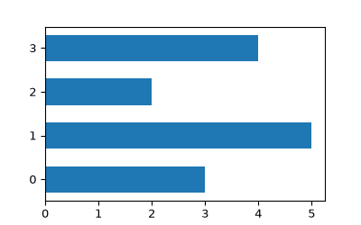

<details>
<summary>Code</summary>

```python
import numpy as np
from matplotlib_utilities import BarhParameters, GraphLayout, GraphParameters, MatplotGraphMaker, TableAxis

layout = GraphLayout.from_number(number=1, axis=TableAxis.COLUMN, axis_value=1)
maker = MatplotGraphMaker(layout=layout, parameters=GraphParameters())
idx = maker.get_subplot_index_from_number(number=0)
maker.barh(
    y=np.arange(4.0),
    width=np.array([3.0, 5.0, 2.0, 4.0]),
    index=idx,
    subparams=BarhParameters(height=0.6),
)
maker.finalize(save_path="out.png", is_showing_result_enabled=False)
```

</details>

## pie

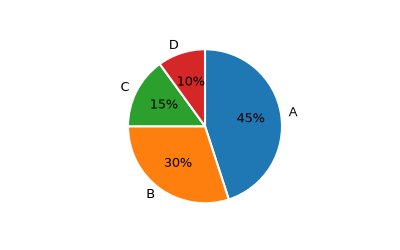

Wedge-wide styling such as outlines or a donut hole goes in `WedgeStyle`, passed as `wedgeprops`.

<details>
<summary>Code</summary>

```python
import numpy as np
from matplotlib_utilities import GraphLayout, GraphParameters, MatplotGraphMaker, PieParameters, TableAxis, WedgeStyle

layout = GraphLayout.from_number(number=1, axis=TableAxis.COLUMN, axis_value=1)
maker = MatplotGraphMaker(layout=layout, parameters=GraphParameters())
idx = maker.get_subplot_index_from_number(number=0)
maker.pie(
    values=np.array([45.0, 30.0, 15.0, 10.0]),
    index=idx,
    labels=["A", "B", "C", "D"],
    subparams=PieParameters(
        autopct="%1.0f%%",
        startangle=90.0,
        counterclock=False,
        wedgeprops=WedgeStyle(edgecolor="white", linewidth=1.5),
    ),
)
maker.finalize(save_path="out.png", is_showing_result_enabled=False)
```

</details>

## quiver

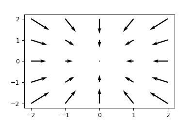

<details>
<summary>Code</summary>

```python
import numpy as np
from matplotlib_utilities import (
    GraphLayout,
    GraphParameters,
    MatplotGraphMaker,
    QuiverAngles,
    QuiverParameters,
    TableAxis,
)

layout = GraphLayout.from_number(number=1, axis=TableAxis.COLUMN, axis_value=1)
maker = MatplotGraphMaker(layout=layout, parameters=GraphParameters())
x = np.linspace(-2, 2, 5)
y = np.linspace(-2, 2, 5)
xx, yy = np.meshgrid(x, y)
idx = maker.get_subplot_index_from_number(number=0)
maker.quiver(
    u=-xx,
    v=-yy,
    x=xx,
    y=yy,
    index=idx,
    subparams=QuiverParameters(angles=QuiverAngles.XY, scale=20.0),
)
maker.finalize(save_path="out.png", is_showing_result_enabled=False)
```

</details>

## arrow

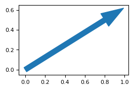

<details>
<summary>Code</summary>

```python
from matplotlib_utilities import ArrowParameters, GraphLayout, GraphParameters, MatplotGraphMaker, TableAxis

layout = GraphLayout.from_number(number=1, axis=TableAxis.COLUMN, axis_value=1)
maker = MatplotGraphMaker(layout=layout, parameters=GraphParameters())
idx = maker.get_subplot_index_from_number(number=0)
maker.arrow(x=0.0, y=0.0, dx=0.8, dy=0.5, index=idx, subparams=ArrowParameters(width=0.05, color="C0"))
maker.finalize(save_path="out.png", is_showing_result_enabled=False)
```

</details>

## legend

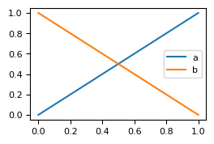

<details>
<summary>Code</summary>

```python
import numpy as np
from matplotlib_utilities import GraphLayout, GraphParameters, MatplotGraphMaker, PlotParameters, TableAxis

layout = GraphLayout.from_number(number=1, axis=TableAxis.COLUMN, axis_value=1)
maker = MatplotGraphMaker(layout=layout, parameters=GraphParameters())
x = np.linspace(0, 1, 20)
idx = maker.get_subplot_index_from_number(number=0)
maker.plot(x=x, y=x, index=idx, subparams=PlotParameters(label="a"))
maker.plot(x=x, y=1 - x, index=idx, subparams=PlotParameters(label="b"))
maker.legend(index=idx)
maker.finalize(save_path="out.png", is_showing_result_enabled=False)
```

</details>

## line

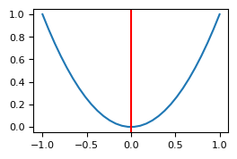

<details>
<summary>Code</summary>

```python
import numpy as np
from matplotlib_utilities import GraphLayout, GraphParameters, LineParameters, MatplotGraphMaker, Orientation, TableAxis

layout = GraphLayout.from_number(number=1, axis=TableAxis.COLUMN, axis_value=1)
maker = MatplotGraphMaker(layout=layout, parameters=GraphParameters())
x = np.linspace(-1, 1, 30)
idx = maker.get_subplot_index_from_number(number=0)
maker.plot(x=x, y=x**2, index=idx)
maker.line(value=0.0, orientation=Orientation.VERTICAL, index=idx, subparams=LineParameters(color="red"))
maker.finalize(save_path="out.png", is_showing_result_enabled=False)
```

</details>

## annotate

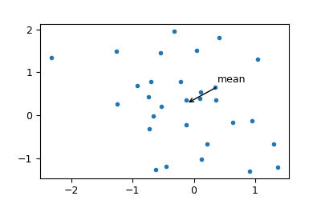

<details>
<summary>Code</summary>

```python
import numpy as np
from matplotlib_utilities import AnnotateParameters, ArrowProperties, GraphLayout, GraphParameters, MatplotGraphMaker, TableAxis

layout = GraphLayout.from_number(number=1, axis=TableAxis.COLUMN, axis_value=1)
maker = MatplotGraphMaker(layout=layout, parameters=GraphParameters())
rng = np.random.default_rng(0)
x, y = rng.standard_normal(30), rng.standard_normal(30)
idx = maker.get_subplot_index_from_number(number=0)
maker.scatter(x=x, y=y, index=idx)
maker.annotate(
    text="mean",
    xy=(float(np.mean(x)), float(np.mean(y))),
    index=idx,
    xytext=(float(np.mean(x)) + 0.5, float(np.mean(y)) + 0.5),
    subparams=AnnotateParameters(arrowprops=ArrowProperties()),
)
maker.finalize(save_path="out.png", is_showing_result_enabled=False)
```

</details>

## step

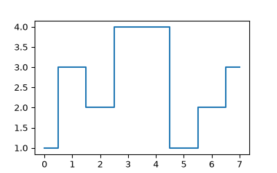

The value holds between x positions; `where` (`StepWhere`) picks where it jumps.

<details>
<summary>Code</summary>

```python
import numpy as np
from matplotlib_utilities import GraphLayout, GraphParameters, MatplotGraphMaker, StepParameters, StepWhere, TableAxis

layout = GraphLayout.from_number(number=1, axis=TableAxis.COLUMN, axis_value=1)
maker = MatplotGraphMaker(layout=layout, parameters=GraphParameters())
idx = maker.get_subplot_index_from_number(number=0)
maker.step(
    x=np.arange(8.0),
    y=np.array([1.0, 3.0, 2.0, 4.0, 4.0, 1.0, 2.0, 3.0]),
    index=idx,
    subparams=StepParameters(where=StepWhere.MID),
)
maker.finalize(save_path="out.png", is_showing_result_enabled=False)
```

</details>

## errorbar

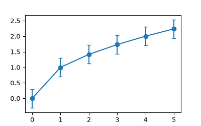

Pass `yerr` and/or `xerr` as one value, one value per point, or a `(2, N)` array of lower and upper errors.

<details>
<summary>Code</summary>

```python
import numpy as np
from matplotlib_utilities import ErrorbarParameters, GraphLayout, GraphParameters, Marker, MatplotGraphMaker, TableAxis

layout = GraphLayout.from_number(number=1, axis=TableAxis.COLUMN, axis_value=1)
maker = MatplotGraphMaker(layout=layout, parameters=GraphParameters())
idx = maker.get_subplot_index_from_number(number=0)
x = np.arange(6.0)
maker.errorbar(
    x=x,
    y=np.sqrt(x),
    yerr=np.full(6, 0.3),
    index=idx,
    subparams=ErrorbarParameters(marker=Marker.CIRCLE, capsize=3.0),
)
maker.finalize(save_path="out.png", is_showing_result_enabled=False)
```

</details>

## fill_between

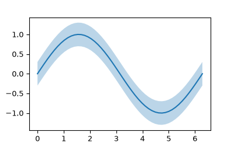

Draws a band such as a confidence interval; `y2` defaults to a zero baseline and `where` masks the fill.

<details>
<summary>Code</summary>

```python
import numpy as np
from matplotlib_utilities import FillBetweenParameters, GraphLayout, GraphParameters, MatplotGraphMaker, TableAxis

layout = GraphLayout.from_number(number=1, axis=TableAxis.COLUMN, axis_value=1)
maker = MatplotGraphMaker(layout=layout, parameters=GraphParameters())
idx = maker.get_subplot_index_from_number(number=0)
x = np.linspace(0, 2 * np.pi, 50)
maker.fill_between(x=x, y1=np.sin(x) - 0.3, y2=np.sin(x) + 0.3, index=idx, subparams=FillBetweenParameters(alpha=0.3))
maker.plot(x=x, y=np.sin(x), index=idx)
maker.finalize(save_path="out.png", is_showing_result_enabled=False)
```

</details>

## stackplot

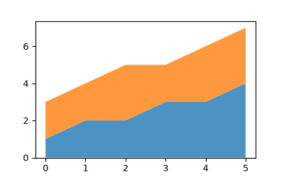

<details>
<summary>Code</summary>

```python
import numpy as np
from matplotlib_utilities import GraphLayout, GraphParameters, MatplotGraphMaker, StackplotParameters, TableAxis

layout = GraphLayout.from_number(number=1, axis=TableAxis.COLUMN, axis_value=1)
maker = MatplotGraphMaker(layout=layout, parameters=GraphParameters())
idx = maker.get_subplot_index_from_number(number=0)
maker.stackplot(
    x=np.arange(6.0),
    ys=[np.array([1.0, 2.0, 2.0, 3.0, 3.0, 4.0]), np.array([2.0, 2.0, 3.0, 2.0, 3.0, 3.0])],
    index=idx,
    labels=["a", "b"],
    subparams=StackplotParameters(alpha=0.8),
)
maker.finalize(save_path="out.png", is_showing_result_enabled=False)
```

</details>

## hist

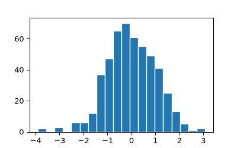

Pass a list of arrays, or a 2-D array with one dataset per column, to compare several datasets; set `stacked=True` to stack them. `boxplot` and `violinplot` read 2-D arrays the same way.

<details>
<summary>Code</summary>

```python
import numpy as np
from matplotlib_utilities import GraphLayout, GraphParameters, HistParameters, MatplotGraphMaker, TableAxis

layout = GraphLayout.from_number(number=1, axis=TableAxis.COLUMN, axis_value=1)
maker = MatplotGraphMaker(layout=layout, parameters=GraphParameters())
idx = maker.get_subplot_index_from_number(number=0)
rng = np.random.default_rng(0)
maker.hist(x=rng.standard_normal(500), index=idx, subparams=HistParameters(bins=20, edgecolor="white"))
maker.finalize(save_path="out.png", is_showing_result_enabled=False)
```

</details>

## boxplot

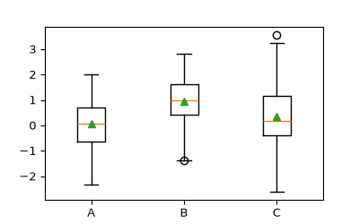

<details>
<summary>Code</summary>

```python
import numpy as np
from matplotlib_utilities import BoxplotParameters, GraphLayout, GraphParameters, MatplotGraphMaker, TableAxis

layout = GraphLayout.from_number(number=1, axis=TableAxis.COLUMN, axis_value=1)
maker = MatplotGraphMaker(layout=layout, parameters=GraphParameters())
idx = maker.get_subplot_index_from_number(number=0)
rng = np.random.default_rng(0)
maker.boxplot(
    data=[rng.normal(loc, 1.0, 100) for loc in (0.0, 1.0, 0.5)],
    index=idx,
    tick_labels=["A", "B", "C"],
    subparams=BoxplotParameters(showmeans=True),
)
maker.finalize(save_path="out.png", is_showing_result_enabled=False)
```

</details>

## violinplot

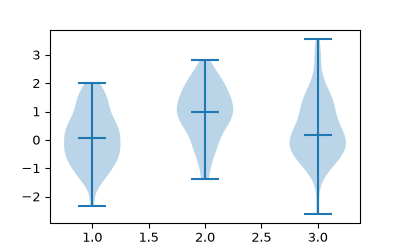

<details>
<summary>Code</summary>

```python
import numpy as np
from matplotlib_utilities import GraphLayout, GraphParameters, MatplotGraphMaker, TableAxis, ViolinplotParameters

layout = GraphLayout.from_number(number=1, axis=TableAxis.COLUMN, axis_value=1)
maker = MatplotGraphMaker(layout=layout, parameters=GraphParameters())
idx = maker.get_subplot_index_from_number(number=0)
rng = np.random.default_rng(0)
maker.violinplot(
    data=[rng.normal(loc, 1.0, 100) for loc in (0.0, 1.0, 0.5)],
    index=idx,
    subparams=ViolinplotParameters(showmedians=True),
)
maker.finalize(save_path="out.png", is_showing_result_enabled=False)
```

</details>

## hexbin

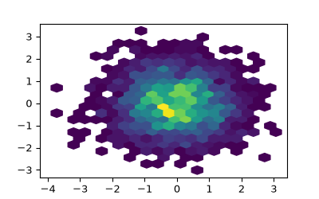

Suited to scatter data too dense to read point by point. Pass `norm=LogNorm()` for skewed counts.

<details>
<summary>Code</summary>

```python
import numpy as np
from matplotlib_utilities import ColorMap, GraphLayout, GraphParameters, HexbinParameters, MatplotGraphMaker, TableAxis

layout = GraphLayout.from_number(number=1, axis=TableAxis.COLUMN, axis_value=1)
maker = MatplotGraphMaker(layout=layout, parameters=GraphParameters())
idx = maker.get_subplot_index_from_number(number=0)
rng = np.random.default_rng(0)
maker.hexbin(
    x=rng.standard_normal(2000),
    y=rng.standard_normal(2000),
    index=idx,
    subparams=HexbinParameters(gridsize=20, mincnt=1, cmap=ColorMap.VIRIDIS),
)
maker.finalize(save_path="out.png", is_showing_result_enabled=False)
```

</details>

## hist2d

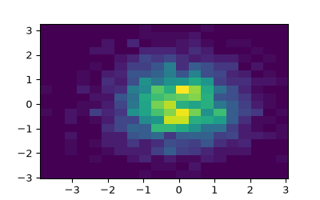

<details>
<summary>Code</summary>

```python
import numpy as np
from matplotlib_utilities import ColorMap, GraphLayout, GraphParameters, Hist2dParameters, MatplotGraphMaker, TableAxis

layout = GraphLayout.from_number(number=1, axis=TableAxis.COLUMN, axis_value=1)
maker = MatplotGraphMaker(layout=layout, parameters=GraphParameters())
idx = maker.get_subplot_index_from_number(number=0)
rng = np.random.default_rng(0)
maker.hist2d(
    x=rng.standard_normal(2000),
    y=rng.standard_normal(2000),
    index=idx,
    subparams=Hist2dParameters(bins=20, cmap=ColorMap.VIRIDIS),
)
maker.finalize(save_path="out.png", is_showing_result_enabled=False)
```

</details>

## contour

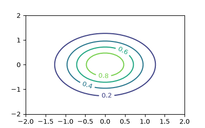

Set `is_labeled=True` to write each level on its line.

<details>
<summary>Code</summary>

```python
import numpy as np
from matplotlib_utilities import ColorMap, ContourParameters, GraphLayout, GraphParameters, MatplotGraphMaker, TableAxis

layout = GraphLayout.from_number(number=1, axis=TableAxis.COLUMN, axis_value=1)
maker = MatplotGraphMaker(layout=layout, parameters=GraphParameters())
idx = maker.get_subplot_index_from_number(number=0)
xx, yy = np.meshgrid(np.linspace(-2, 2, 50), np.linspace(-2, 2, 50))
maker.contour(
    z=np.exp(-(xx**2) - yy**2),
    x=xx,
    y=yy,
    index=idx,
    is_labeled=True,
    subparams=ContourParameters(levels=5, cmap=ColorMap.VIRIDIS),
)
maker.finalize(save_path="out.png", is_showing_result_enabled=False)
```

</details>

## contourf

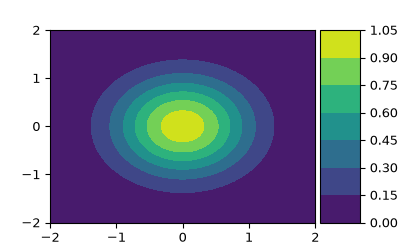

<details>
<summary>Code</summary>

```python
import numpy as np
from matplotlib_utilities import ColorMap, ContourfParameters, GraphLayout, GraphParameters, MatplotGraphMaker, TableAxis

layout = GraphLayout.from_number(number=1, axis=TableAxis.COLUMN, axis_value=1)
maker = MatplotGraphMaker(layout=layout, parameters=GraphParameters())
idx = maker.get_subplot_index_from_number(number=0)
xx, yy = np.meshgrid(np.linspace(-2, 2, 50), np.linspace(-2, 2, 50))
z = np.exp(-(xx**2) - yy**2)
bands = maker.contourf(z=z, x=xx, y=yy, index=idx, subparams=ContourfParameters(levels=8, cmap=ColorMap.VIRIDIS))
maker.set_colorbar(index=idx, mappable=bands)
maker.finalize(save_path="out.png", is_showing_result_enabled=False)
```

</details>

## pcolormesh

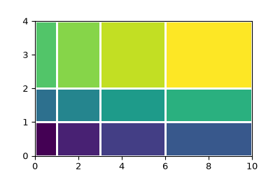

Unlike `imshow`, the cells may be unevenly spaced.

<details>
<summary>Code</summary>

```python
import numpy as np
from matplotlib_utilities import ColorMap, GraphLayout, GraphParameters, MatplotGraphMaker, PcolormeshParameters, Shading, TableAxis

layout = GraphLayout.from_number(number=1, axis=TableAxis.COLUMN, axis_value=1)
maker = MatplotGraphMaker(layout=layout, parameters=GraphParameters())
idx = maker.get_subplot_index_from_number(number=0)
maker.pcolormesh(
    z=np.arange(12.0).reshape(3, 4),
    x=np.array([0.0, 1.0, 3.0, 6.0, 10.0]),
    y=np.array([0.0, 1.0, 2.0, 4.0]),
    index=idx,
    subparams=PcolormeshParameters(shading=Shading.FLAT, edgecolors="white", cmap=ColorMap.VIRIDIS),
)
maker.finalize(save_path="out.png", is_showing_result_enabled=False)
```

</details>

## imscatter

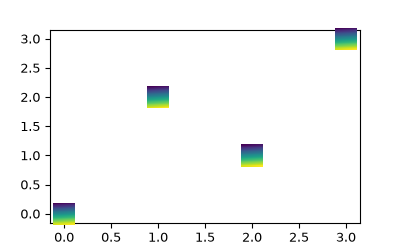

Places an image at each point instead of a marker. Pass one image to repeat it, or one image per point.

<details>
<summary>Code</summary>

```python
import numpy as np
from matplotlib_utilities import ColorMap, GraphLayout, GraphParameters, ImscatterParameters, MatplotGraphMaker, TableAxis

layout = GraphLayout.from_number(number=1, axis=TableAxis.COLUMN, axis_value=1)
maker = MatplotGraphMaker(layout=layout, parameters=GraphParameters())
idx = maker.get_subplot_index_from_number(number=0)
icon = np.linspace(0, 1, 16 * 16).reshape(16, 16)
maker.imscatter(
    x=np.array([0.0, 1.0, 2.0, 3.0]),
    y=np.array([0.0, 2.0, 1.0, 3.0]),
    images=[icon],
    index=idx,
    subparams=ImscatterParameters(zoom=1.0, cmap=ColorMap.VIRIDIS),
)
maker.finalize(save_path="out.png", is_showing_result_enabled=False)
```

</details>

## streamplot

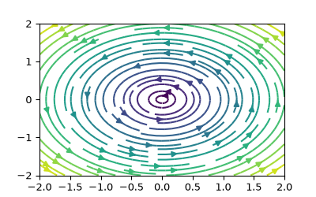

`color_values` colors the streamlines through the colormap, for example by speed.

<details>
<summary>Code</summary>

```python
import numpy as np
from matplotlib_utilities import ColorMap, GraphLayout, GraphParameters, MatplotGraphMaker, StreamplotParameters, TableAxis

layout = GraphLayout.from_number(number=1, axis=TableAxis.COLUMN, axis_value=1)
maker = MatplotGraphMaker(layout=layout, parameters=GraphParameters())
idx = maker.get_subplot_index_from_number(number=0)
x = np.linspace(-2, 2, 30)
y = np.linspace(-2, 2, 30)
xx, yy = np.meshgrid(x, y)
maker.streamplot(
    x=x,
    y=y,
    u=-yy,
    v=xx,
    color_values=np.hypot(xx, yy),
    index=idx,
    subparams=StreamplotParameters(cmap=ColorMap.VIRIDIS),
)
maker.finalize(save_path="out.png", is_showing_result_enabled=False)
```

</details>

## span

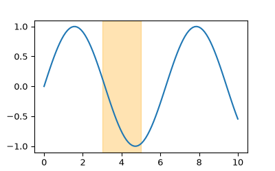

Shades a band across the whole subplot: `Orientation.VERTICAL` covers an x range, `Orientation.HORIZONTAL` a y range.

<details>
<summary>Code</summary>

```python
import numpy as np
from matplotlib_utilities import GraphLayout, GraphParameters, MatplotGraphMaker, Orientation, SpanParameters, TableAxis

layout = GraphLayout.from_number(number=1, axis=TableAxis.COLUMN, axis_value=1)
maker = MatplotGraphMaker(layout=layout, parameters=GraphParameters())
idx = maker.get_subplot_index_from_number(number=0)
x = np.linspace(0, 10, 100)
maker.plot(x=x, y=np.sin(x), index=idx)
maker.span(start=3.0, end=5.0, orientation=Orientation.VERTICAL, index=idx, subparams=SpanParameters(color="orange", alpha=0.3))
maker.finalize(save_path="out.png", is_showing_result_enabled=False)
```

</details>
